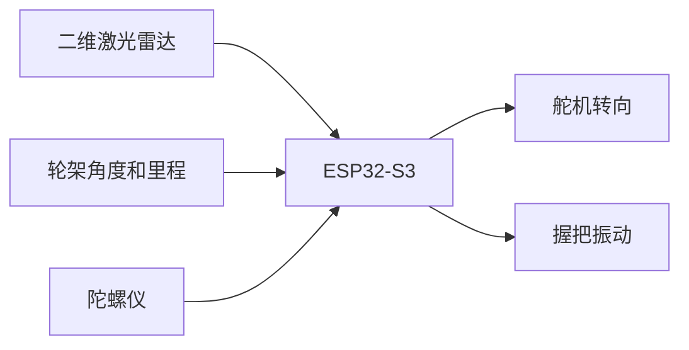

# 双轮式智能导盲杖 · Smart Guide Cane

## 比赛佐证 · 原型 v0.1.0

本项目探索在室内受控场景中，为手推式双轮导盲杖增加障碍感知、辅助转向和振动提示。仓库提供 ESP32-S3 固件、C++ 控制核心、装配和接线资料，以及可在电脑上运行的测试。

- [软件测试记录](docs/competition-test-report.md)涵盖直行、左绕、右绕、道路阻塞和雷达数据超时。
- [固件源码](firmware/GuideCane)和[控制说明](docs/control.md)可用于查看程序如何处理传感器输入、转向和停步提示。
- [机械结构](docs/mechanics.md)、[接线说明](docs/wiring.md)与[物料清单](hardware/bom.csv)记录原型设计。

电脑端 CTest 已通过。实物照片、演示视频与实物测试数据待补充。

这是一个面向室内受控演示的 ESP32-S3 开源原型。操作者推着两只自由滚动的轮子前进，激光雷达识别扫描平面内的障碍，舵机转动整个轮架。握把振动用于提示转向或停步，制动由操作者捏机械手刹完成。断电后手刹仍应可用。



软件将雷达回波投影到局部栅格，分别检查直行、左绕和右绕。如果候选路径的预留宽度和观测范围满足要求，轮架先斜行避开障碍，再回到参考航向。遇到阻塞、未知区域、输入超时或反馈异常时，系统关断舵机并提示操作者停步。绕行结束后允许保留横向偏移。

**使用范围**为有人旁站的室内台架及封闭平地软障碍实验。使用者必须能看见试验场地并能立即停步及操作手刹。二维雷达只观测单一高度，可能漏检玻璃、台阶、落差、低矮物或悬空物。样机禁止承重、独立出行和公共道路试用。

## 在电脑上运行

需要 CMake 3.16+ 和支持 C++17 的编译器。Windows 可在 Visual Studio Developer PowerShell 中执行，Linux 和 macOS 可使用自带的 C++ 构建工具。

```sh
cmake -S . -B build
cmake --build build --config Release
ctest --test-dir build -C Release --output-on-failure
```

Windows 使用 Visual Studio 生成器时运行 `./build/Release/cane_demo.exe left`。Linux 或 macOS 使用单配置生成器时运行 `./build/cane_demo left`。场景有 `straight`、`left`、`right`、`blocked`、`scan-loss`。演示用合成栅格和理想舵机反馈展示状态转移，实物覆盖率和制动性能需另行测量。

## 编译 ESP32-S3 固件

选择 ESP32-S3 Dev Module，使用 [Espressif Arduino-ESP32](https://docs.espressif.com/projects/arduino-esp32/en/latest/installing.html) `3.3.0`。在 Arduino IDE 打开 [`GuideCane.ino`](firmware/GuideCane/GuideCane.ino)，也可以在仓库根目录用 Arduino CLI 编译。

```sh
arduino-cli core update-index --additional-urls https://espressif.github.io/arduino-esp32/package_esp32_index.json
arduino-cli core install esp32:esp32@3.3.0 --additional-urls https://espressif.github.io/arduino-esp32/package_esp32_index.json
arduino-cli compile --fqbn esp32:esp32:esp32s3 firmware/GuideCane
arduino-cli board list
```

用 `arduino-cli upload --fqbn esp32:esp32:esp32s3 -p COM5 firmware/GuideCane` 烧录，把 `COM5` 换成实际端口。串口日志为 115200 baud。初次烧录时 [`board_config.h`](firmware/GuideCane/board_config.h) 中的 `enableSteering` 保持为 `false`，这样接传感器读数据时舵机供电保持关断。

## 制作和验收

| 文件 | 用途 |
| --- | --- |
| [物料清单](hardware/bom.csv) | 采购、核对尺寸和接口 |
| [机械结构与装配](docs/mechanics.md) | 轮架、拉线手刹、转轴和雷达安装 |
| [双轮装配布局](hardware/layout.scad) | 在 OpenSCAD 中调整轮距、支架及扫描面，检查安装空间 |
| [供电和接线](docs/wiring.md) | GPIO、电源分路、舵机硬件联锁 |
| [标定和台架验收](docs/bringup.md) | 启动检查、方向校准、停步测距、故障注入 |
| [控制与数据](docs/control.md) | 坐标、规划、故障状态和串口日志 |

目前提供 C++ 控制核心、ESP32-S3 固件、合成数据测试与模块化装配资料。实物标定、雷达兼容性、机械强度和软障碍测试均需在实际样机上验收。请在提交 Issue 时附开发板及电气版本、参数和脱敏后的串口记录。

本仓库新增的源代码和原型资料采用 [MIT License](LICENSE)。外部芯片数据手册及 Arduino-ESP32 等依赖按各自许可使用。
