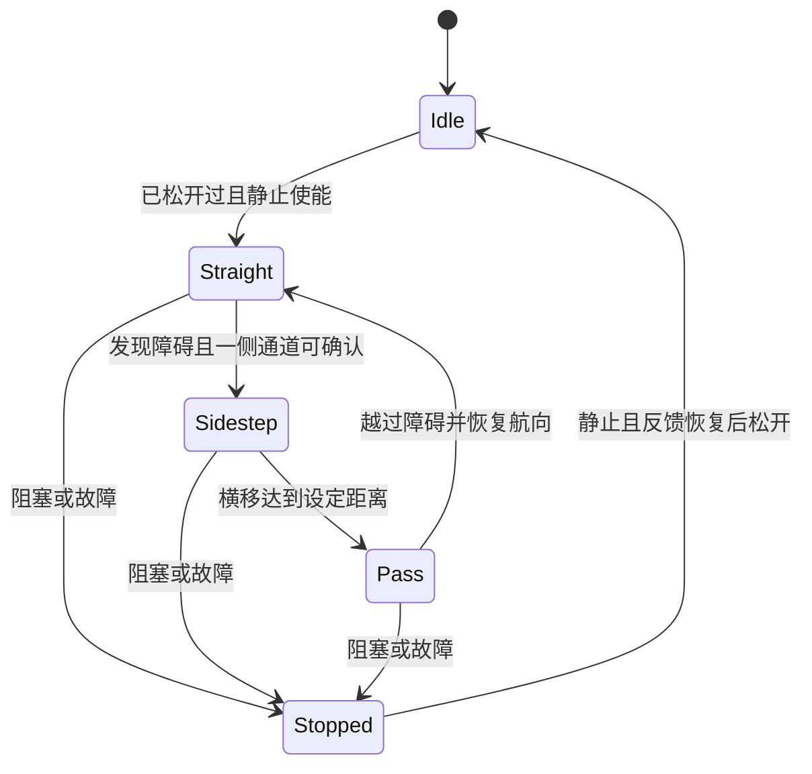

# 控制与数据

坐标原点在两轮轴心中点，X 向前，Y 向左，转向角左正右负。雷达通过 A1 标准串口 SCAN 回包返回五字节测量点。固件校验帧头与同步角扫过范围，把有效回波投到轴心坐标，将光束穿过的格记为可见空闲、命中格记为占用。缺失回波和遮挡保留未知。地图分辨率 5 cm，覆盖轴心周围 6 m × 6 m，每次用最新完整扫描重建。

控制循环目标为 40 Hz。直行检查前方约 1.80 m，并始终检查实测轮向上约 0.80 m 的停步通道。通道左右各检查 0.50 m，对当前轮架角与目标角之间的角度也抽样检查。轴心附近 `−0.10 m ≤ X ≤ 0.25 m` 的起步占用范围需要操作者直接确认，代码在此区域仍拒绝雷达已命中的障碍。通道净宽必须按操作者实测包络、推行姿势和安全余量调整。

有前方障碍时，从软件限位以内的 ±15°、±25°、±35° 检查候选，按较小角度优先、同角度左侧先查。两段路径均需可见。开始绕行后记住所选方向，积分短时陀螺仪相对航向，结合转向角以及两轮脉冲均值估计横移和通过距离。转向变化率初始限制为 65°/s。停步提示采用连续振动，绕行开始用约 120 ms 短振。

| 停步编码 | 触发条件 |
| --- | --- |
| `scan-stale` | 缺少完整扫描、结束时间距当前超过 300 ms、单帧耗时超过 300 ms 或该帧最早回波超过 450 ms |
| `sensors` | 角度、陀螺仪、编码器、PWM 或电池检查失败 |
| `control-late` | 控制循环间隔超过 125 ms |
| `speed` | 启动时移动、明显倒退或超过速度限制 |
| `steering` | 轮角越界、启动偏离中位或角度命令与实测偏差持续超限 |
| `obstacle` | 停步通道命中障碍，或直行遇险且两侧均无可用候选 |
| `unknown-path` | 无法确认所需通道为空闲 |
| `timeout` | 绕行超过 20 s 或相对航向偏差超过 45° |

串口字段依次为运行时间（ms）、状态、停步编码、点数 `pts`、扫描末点年龄 `age`、累计无效节点 `bad`、轮架原始计数和角度 `w`、目标角 `cmd`、两轮累计计数 `L/R`、速度 `v`、电池电压 `V`、零偏校正后的陀螺仪读数 `gz`，以及五位 `ok` 标志（PWM／编码器／轮架角／陀螺仪／电池）。

地图在扫描之间保留上一帧，位置估计仅用于本次绕行。新帧覆盖不足会引起保守停步，窄走廊和吸光表面需要实测。轮子打滑和陀螺仪漂移会影响位置估计，双侧编码器同时无脉冲时无法区分静止和反馈同时丢失。左右栅格与局部规划可在电脑上测试，操作者轨迹和实物制动仍按台架流程验收。
