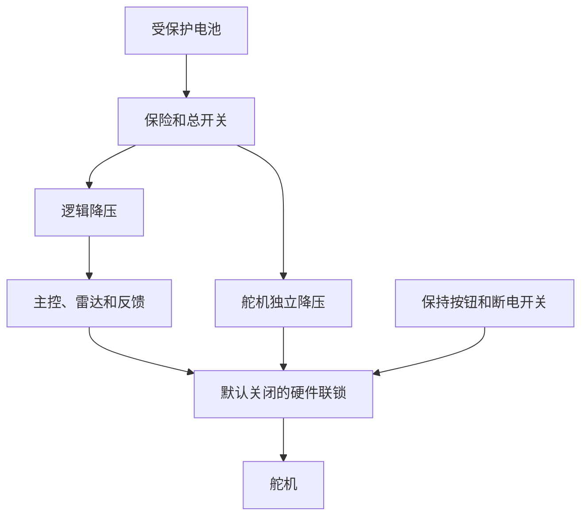

# 供电和接线

以下引脚对应固件默认配置。核对所购 ESP32-S3 开发板和模块版本的原理图，尤其注意供电端与逻辑接口的电平。ESP32-S3 的 GPIO 使用 3.3 V 逻辑。 [Espressif 硬件设计指南](https://docs.espressif.com/projects/esp-hardware-design-guidelines/en/latest/esp32s3/schematic-checklist.html)

| GPIO | 方向 | 连接 |
| --- | --- | --- |
| 4 | 输入 | 握把保持按钮的独立触点。按下接地，松开由上拉保持高电平 |
| 5 | 输出 | 舵机供电允许，外部联锁逻辑输入，建议外置下拉使 MCU 重启时默认关闭 |
| 6 | 输出 | 舵机控制 PWM，信号限流或隔离按舵机输入要求选型 |
| 7 | 输出 | 振动马达驱动器的逻辑输入 |
| 8 | 模拟输入 | 电池分压输出，GPIO8 对应 ADC1_CH7 |
| 9 | UART RX | 接雷达 TX，按雷达版本验证电平 |
| 10 | UART TX | 接雷达 RX，按雷达版本验证驱动和电平 |
| 11、12 | I²C | SDA、SCL，AS5600 为 `0x36`，ICM-42688-P 默认 `0x68`，总线上拉到 3.3 V |
| 13、14 | 输入 | 左轮编码器 A、B |
| 15、16 | 输入 | 右轮编码器 A、B |

- **逻辑支路**以所购开发板和雷达电源需求为准，优先用原厂适配板验证雷达已稳定出点，再使用所购 A1M8 版本的 UART 与电机使能接法。固件通过 115200 8N1 发标准 SCAN 指令，扫描电机需由适配板或相应驱动转动。若适配板用 USB 串口，改为 MCU UART 前，需要隔离适配板可能还在驱动的 TX。 [Slamtec 型号手册与协议](https://www.slamtec.com/en/support)
- **舵机支路**使用额定电压、持续及峰值电流与舵机相符的独立电源。舵机电源须同时满足握把物理触点闭合、舵机断电开关合上、GPIO5 为高才允许导通。保持按钮建议用独立的两组触点，一组给 MCU 读取，另一组串入联锁控制。DC 负载开关承受舵机电流，握把小信号触点只控制联锁输入。先用限流电源和假负载测任一路失效均能关断，再接舵机。舵机电源电流的回路单独回到电源共地点。
- **振动反馈**由合适的晶体管或马达驱动器供电，感性负载按驱动器规范接续流或抑制电路。根据马达铭牌设置供电和限流。GPIO7 只输出逻辑电平。
- **电池分压**示例为 51 kΩ 上臂、10 kΩ 下臂，对 12.6 V 约输出 2.07 V。分压器接到总开关后的电池测点，校对 ADC 读数和万用表读数，确认最大充满电压及瞬态在 GPIO/ADC 容许范围内。按电池和保护板资料实测低压并配置阈值。用保护板、匹配的充电器和靠近电池的保险。 [ESP32-S3 ADC 建议](https://docs.espressif.com/projects/esp-hardware-design-guidelines/en/latest/esp32s3/schematic-checklist.html)
- **轮和角度反馈**编码器需提供正交 A/B 信号。开漏输出只上拉到 3.3 V；其他高电平输出按需做转换。AS5600、IMU 和 MCU 共地。先核对模块自带上拉电阻及供电域。 [AS5600 数据手册](https://look.ams-osram.com/m/3ac60b27c91075b5/original/AS5600-FS000133-2-00.pdf) · [ICM-42688-P 数据手册入口](https://www.invensense.tdk.com/en-us/products/consumer/icm-42688-p)

机械手刹直接拉动刹车件。舵机断电后轮架可能停在当前角度，手刹必须覆盖全转向范围。实物联锁也需要测试 MCU 卡住且 GPIO5 维持高电平的情况，操作者仍可用握把物理触点或断电开关立即切除舵机支路。
